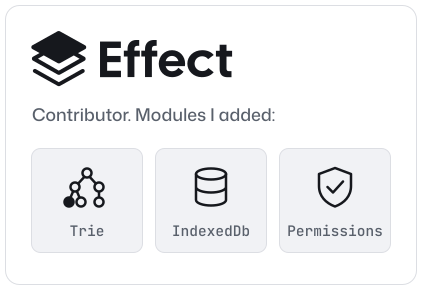
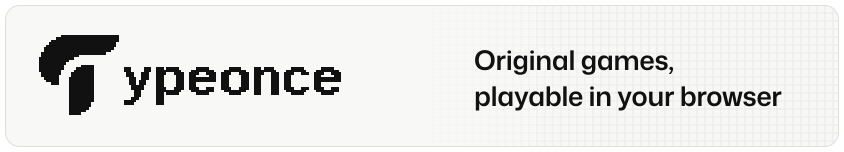
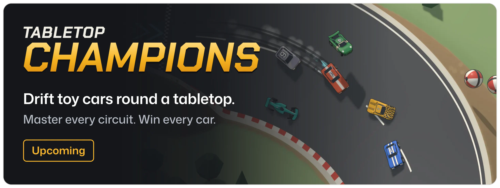
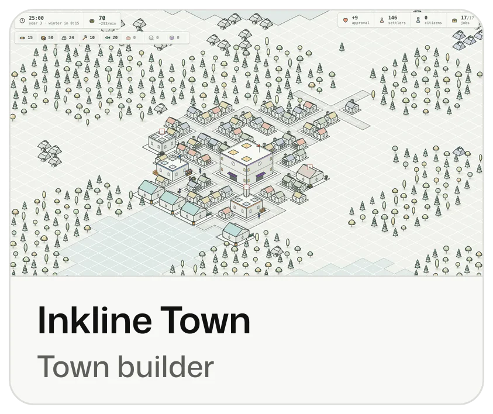
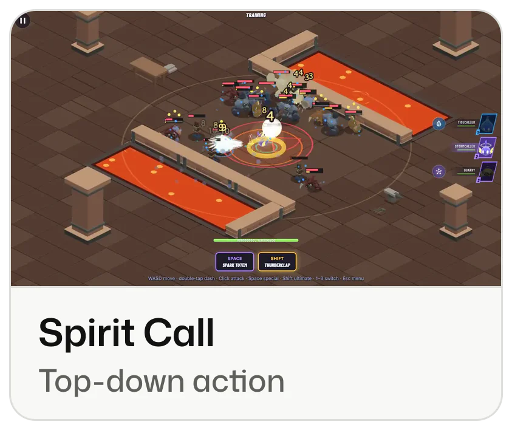

  <a href="https://www.sandromaglione.com"><picture><source media="(prefers-color-scheme: dark)" srcset="./assets/hero-dark.svg"></picture></a> 
  <a href="https://github.com/typeonce-dev/ritmo"><picture><source media="(prefers-color-scheme: dark)" srcset="./assets/ritmo-dark.svg"></picture></a> 
  <a href="https://github.com/search?q=org%3AEffect-TS+author%3ASandroMaglione+is%3Apr+is%3Amerged&type=pullrequests"><picture><source media="(prefers-color-scheme: dark)" srcset="./assets/effect-dark.svg"></picture></a><a href="https://github.com/typeonce-dev/effect-machine"><picture><source media="(prefers-color-scheme: dark)" srcset="./assets/effect-machine-dark.svg"></picture></a> 
  <a href="https://typeonce.games"><picture><source media="(prefers-color-scheme: dark)" srcset="./assets/typeonce-games-dark.svg"></picture></a> 
  <a href="https://typeonce.games/tabletop-champions"><picture><source media="(prefers-color-scheme: dark)" srcset="./assets/game-tabletop-champions-dark.webp"></picture></a> 
  <a href="https://inkline.typeonce.games"><picture><source media="(prefers-color-scheme: dark)" srcset="./assets/game-inkline-town-dark.webp"></picture></a><a href="https://spirit-call.typeonce.games"><picture><source media="(prefers-color-scheme: dark)" srcset="./assets/game-spirit-call-dark.webp"></picture></a> 
  <a href="https://www.sandromaglione.com"><picture><source media="(prefers-color-scheme: dark)" srcset="./assets/sandromaglione-dark.svg"></picture></a> 
  <a href="https://x.com/SandroMaglione"><picture><source media="(prefers-color-scheme: dark)" srcset="./assets/x-dark.svg"></picture></a><a href="https://typeonce.games/discord"><picture><source media="(prefers-color-scheme: dark)" srcset="./assets/discord-dark.svg"></picture></a>

